# Relatório Técnico: Tech Challenge Fase 1

## Sistema de apoio ao diagnóstico de câncer de mama com Machine Learning

Repositório: https://github.com/GustavoHMS21/postech-tech-challenge-fase1-cancer-mama

Vídeo de demonstração: _[inserir link]_

---

## 1. Problema

O hospital universitário descrito no desafio busca reduzir o tempo de triagem e apoiar decisões clínicas a partir
de exames. Este trabalho implementa a primeira etapa desse sistema: um classificador que, com base nas medidas
extraídas de um exame citológico por punção aspirativa por agulha fina (PAAF) de massa mamária, estima a
probabilidade de o tumor ser maligno e indica quais medidas mais influenciaram a estimativa.

A saída do sistema é uma sugestão acompanhada de probabilidade e explicação. A decisão diagnóstica permanece com o
profissional de saúde.

## 2. Dataset

Breast Cancer Wisconsin (Diagnostic), disponível no UCI Machine Learning Repository e no Kaggle
(`uciml/breast-cancer-wisconsin-data`). O conjunto possui 569 exames e 30 atributos numéricos contínuos,
correspondentes a 10 características do núcleo celular (raio, textura, perímetro, área, suavidade, compacidade,
concavidade, pontos côncavos, simetria e dimensão fractal), cada uma em três estatísticas: média (`mean`),
erro-padrão (`error`) e maior valor observado (`worst`).

| Classe | n | Proporção |
|---|---|---|
| Benigno (0) | 357 | 62,7% |
| Maligno (1) | 212 | 37,3% |

Foi utilizada a cópia distribuída com o scikit-learn (`load_breast_cancer`), com conteúdo idêntico ao do Kaggle,
o que elimina download manual e torna a execução reprodutível. O alvo foi recodificado para 1 = maligno, de forma
que recall, precisão e F1 meçam diretamente a detecção da doença.

## 3. Análise exploratória

### 3.1 Qualidade dos dados

Não há valores ausentes, variáveis categóricas ou valores fisicamente inválidos (por exemplo, medidas negativas).
Essas condições são verificadas por testes automatizados (`tests/test_data.py`).

### 3.2 Balanceamento

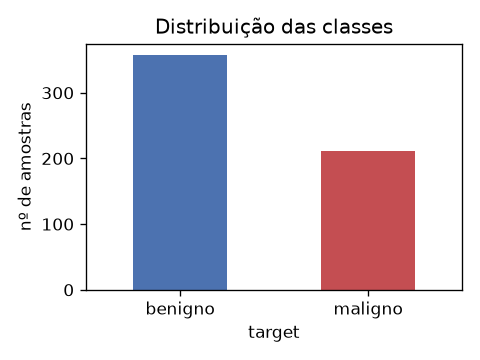

O desbalanceamento é moderado (63/37). Um classificador que sempre prevê "benigno" obtém accuracy de 62,7%,
o que torna essa métrica insuficiente isoladamente e motiva a priorização de recall e F1 (seção 6).

### 3.3 Distribuições

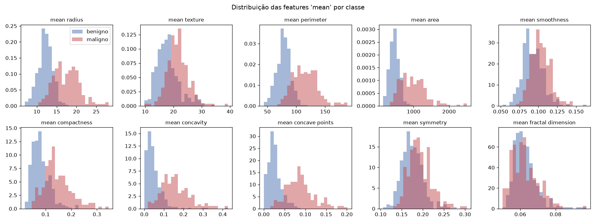

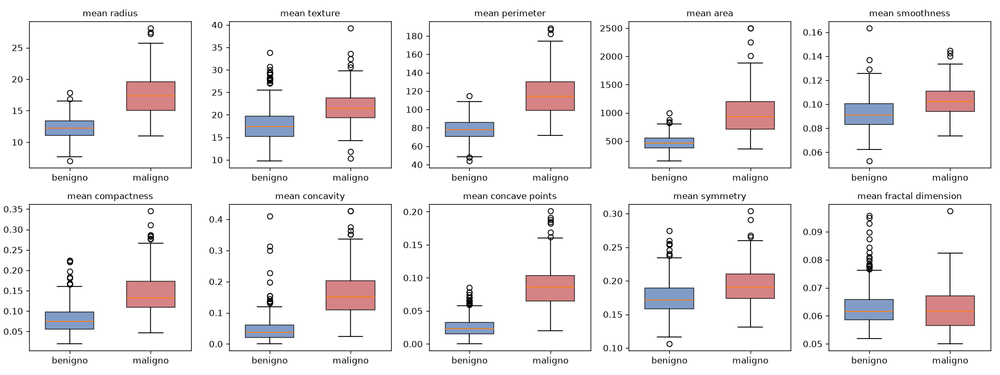

As features de tamanho (`radius`, `perimeter`, `area`) e de irregularidade do contorno (`concavity`,
`concave points`) apresentam pouca sobreposição entre as classes: tumores malignos são maiores e mais irregulares.
`smoothness`, `symmetry` e `fractal dimension` mostram sobreposição elevada e baixo poder discriminante isolado.
As distribuições são assimétricas à direita, com outliers concentrados na classe maligna. Esses valores
correspondem a tumores de grande dimensão e não a erros de medição, por isso foram mantidos.

### 3.4 Correlação

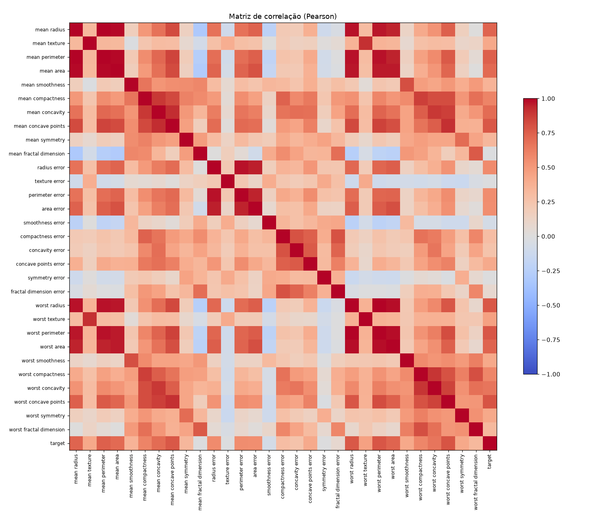

| Feature | Correlação com o alvo |
|---|---|
| worst concave points | 0,79 |
| worst perimeter | 0,78 |
| mean concave points | 0,78 |
| worst radius | 0,78 |
| mean perimeter | 0,74 |

A matriz evidencia multicolinearidade forte: `radius`, `perimeter` e `area` apresentam r ≈ 0,99 entre si, e as
versões `mean` e `worst` de uma mesma medida são altamente correlacionadas. Isso levou a duas decisões: uso de
regularização L2 na regressão logística e interpretação das importâncias por grupos de features, e não por
variáveis isoladas.

## 4. Pré-processamento

1. **Divisão dos dados antes de qualquer ajuste.** Treino 60% (341), validação 20% (114) e teste 20% (114),
   estratificada pelo alvo (127, 43 e 42 malignos, respectivamente) e com `random_state=42`. A validação é usada
   para comparar e selecionar modelos; o teste é usado uma única vez, na avaliação final.
2. **Padronização.** `StandardScaler` (média 0, desvio-padrão 1), pois as escalas variam de 10⁻² (`fractal
   dimension`) a 10³ (`area`) e a regressão logística regularizada é sensível à escala.
3. **Prevenção de vazamento de dados.** O scaler e o classificador estão no mesmo `Pipeline` do scikit-learn.
   Os parâmetros de padronização são estimados somente com o treino e aplicados aos demais conjuntos.
4. **Limpeza, imputação e codificação.** Não aplicadas, pois a análise exploratória confirmou ausência de nulos e
   de variáveis categóricas.

## 5. Modelos

| Modelo | Configuração | Justificativa |
|---|---|---|
| Regressão Logística | L2, C = 1, `max_iter=1000` | Modelo linear de referência para classificação binária, com coeficientes interpretáveis; a regularização reduz o efeito da multicolinearidade. |
| Random Forest | 200 árvores, `class_weight="balanced"` | Modelo não linear, captura interações e é robusto a outliers; o peso balanceado aumenta a penalização de erros na classe maligna. |

Os dois modelos representam abordagens distintas (linear e ensemble de árvores) e permitem verificar se a
complexidade adicional da Random Forest traz ganho neste problema.

## 6. Métricas

- **Recall da classe maligna (sensibilidade):** métrica prioritária. Um falso negativo corresponde a um câncer
  classificado como benigno, com potencial atraso no tratamento, e é o erro de maior custo clínico.
- **F1-score:** média harmônica entre precisão e recall. Penaliza a estratégia de elevar o recall classificando
  casos em excesso como malignos, o que aumentaria procedimentos desnecessários.
- **Accuracy:** reportada como visão geral, interpretada com cautela devido ao desbalanceamento.

## 7. Resultados

### 7.1 Validação (n = 114, 43 malignos)

| Modelo | Accuracy | Recall | F1 |
|---|---|---|---|
| Regressão Logística | 0,974 | 0,977 | 0,966 |
| Random Forest | 0,974 | 0,953 | 0,965 |

A Regressão Logística obteve o maior recall na validação (42 de 43 malignos detectados, contra 41 da Random
Forest) e foi selecionada como modelo final.

### 7.2 Teste (n = 114, 42 malignos)

| Modelo | Accuracy | Recall | F1 | VN | FP | FN | VP |
|---|---|---|---|---|---|---|---|
| Regressão Logística | 0,974 | 0,952 | 0,964 | 71 | 1 | 2 | 40 |
| Random Forest | 0,974 | 0,952 | 0,964 | 71 | 1 | 2 | 40 |

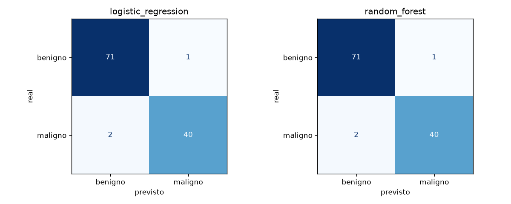

No teste, os dois modelos apresentaram métricas idênticas: 40 dos 42 malignos detectados e 1 falso positivo
(precisão de 0,976). O intervalo de confiança de 95% para o recall (método de Wilson, 40/42) vai de 0,84 a 0,99.
A diferença observada na validação corresponde a um único paciente e está dentro dessa margem, portanto não há
evidência de superioridade de um modelo sobre o outro em desempenho.

Com desempenho equivalente, a Regressão Logística é mantida como modelo final por ser mais simples, por ter
coeficientes diretamente interpretáveis e por produzir explicações SHAP exatas. O resultado é coerente com as
características do dataset: amostra pequena e classes quase linearmente separáveis após a padronização.

### 7.3 Análise dos erros

| Modelo | Paciente (teste) | Tipo | Probabilidade de maligno |
|---|---|---|---|
| Regressão Logística | #4 | FP | 0,670 |
| Regressão Logística | #16 | FN | 0,070 |
| Regressão Logística | #112 | FN | 0,465 |
| Random Forest | #16 | FN | 0,345 |
| Random Forest | #42 | FN | 0,435 |
| Random Forest | #92 | FP | 0,520 |

Embora as métricas sejam iguais, os modelos erram pacientes diferentes. O paciente #16 é um falso negativo nos
dois modelos e recebe probabilidade de apenas 7% na Regressão Logística, ou seja, é um caso maligno com perfil
citológico típico de benigno. Esse tipo de erro não é sinalizado pela faixa de incerteza e só pode ser
identificado com a avaliação clínica completa. Os demais erros da Regressão Logística (#4 e #112) estão na faixa
intermediária de probabilidade (30% a 70%), que a interface destaca para revisão prioritária.

## 8. Interpretação

### 8.1 Feature importance

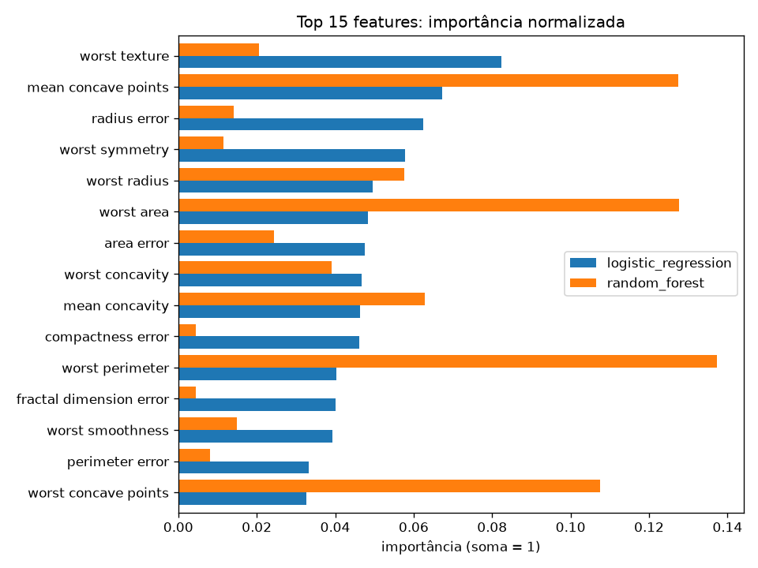

Para a Regressão Logística foi utilizado o valor absoluto dos coeficientes, comparáveis entre si porque as
features estão padronizadas. Para a Random Forest, a redução média de impureza. Ambas foram normalizadas para
soma 1.

- Regressão Logística: `worst texture`, `mean concave points`, `radius error`, `worst symmetry`, `worst radius`.
- Random Forest: `mean concave points`, `worst area`, `worst radius`, `worst concavity`.

### 8.2 SHAP

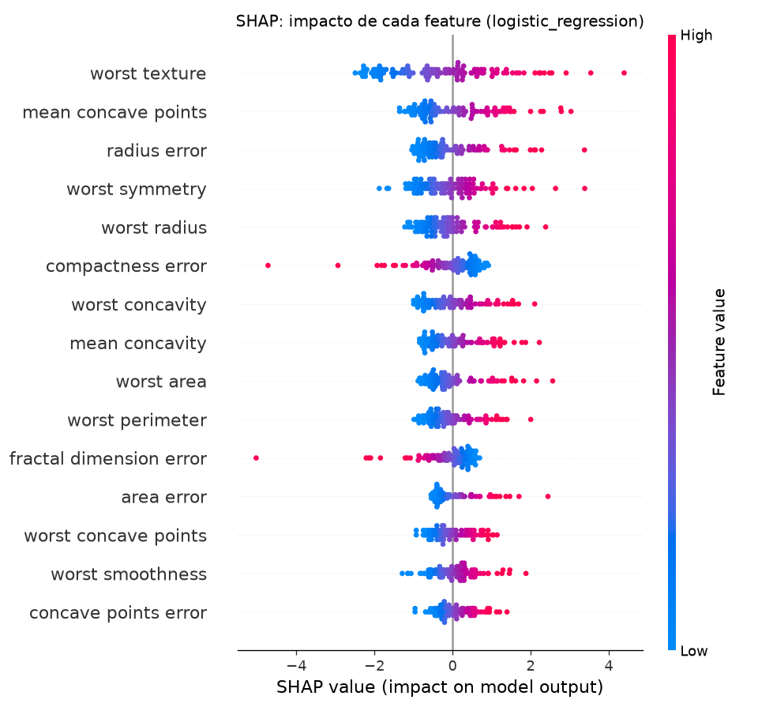

O gráfico beeswarm mostra, para cada paciente do teste, a contribuição de cada feature para a previsão. Valores
altos de `worst texture`, `mean concave points`, `radius error`, `worst symmetry` e `worst radius` aumentam a
probabilidade de malignidade. Valores altos de `compactness error` e `fractal dimension error` reduzem essa
probabilidade.

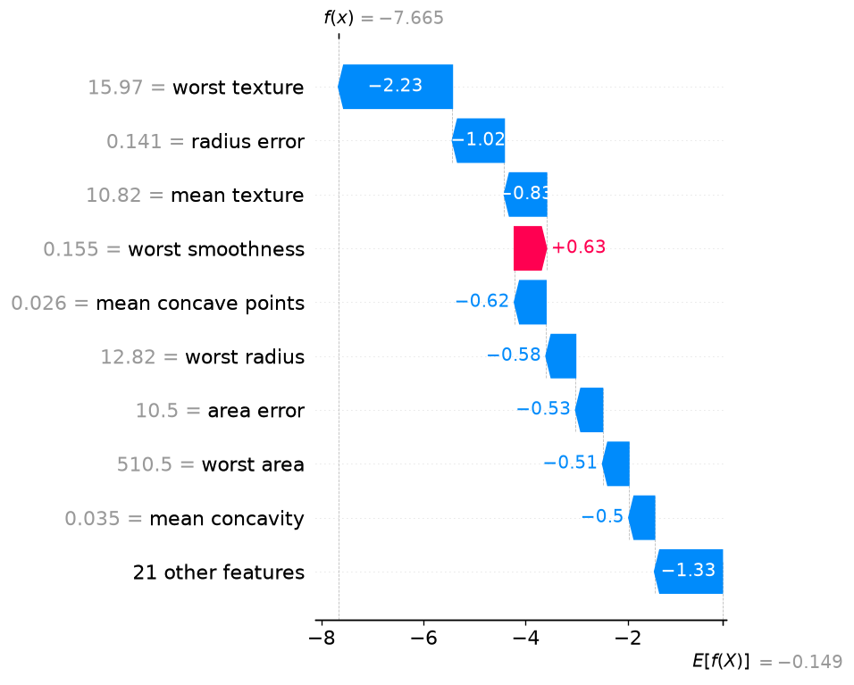

O gráfico waterfall decompõe a previsão de um paciente: parte do valor esperado do modelo e adiciona a
contribuição de cada medida até o valor final (em log-odds). É o formato exibido na interface para cada caso
avaliado.

### 8.3 Efeito da multicolinearidade

O ranking do modelo difere do ranking de correlação simples: `worst concave points` lidera a correlação com o
alvo, mas tem peso menor na Regressão Logística. Quando várias features carregam a mesma informação, o modelo
distribui o peso entre elas de forma não única. O mesmo efeito explica os coeficientes negativos de
`compactness error` e `fractal dimension error`: condicionados às demais variáveis, eles atuam como termos de
ajuste, e não como indicadores biológicos de benignidade. Por esse motivo, a interpretação clínica deve considerar
grupos de features (tamanho, irregularidade do contorno, textura) e não variáveis isoladas.

## 9. Discussão crítica

O modelo é adequado como ferramenta de apoio à triagem, com supervisão médica. Não é adequado como diagnóstico
automático, pelos motivos abaixo.

- **Erros residuais.** O modelo deixou de detectar 2 de 42 malignos no teste (cerca de 5%), e um deles com
  probabilidade baixa. Todo caso precisa ser revisado pelo médico, com prioridade para a faixa intermediária.
- **Tamanho e origem dos dados.** São 569 exames de um único centro, coletados no início da década de 1990.
  Populações, equipamentos e protocolos de medição diferentes podem reduzir o desempenho (dataset shift). O uso
  real exigiria validação externa e prospectiva e aprovação regulatória (no Brasil, ANVISA para software como
  dispositivo médico).
- **Escopo das informações.** O modelo utiliza apenas as 30 medidas citológicas e não considera histórico,
  exame físico, exames de imagem ou laudo histopatológico.
- **Incerteza da estimativa.** Com 42 malignos no teste, o intervalo de confiança do recall é amplo (0,84 a 0,99).
  A estimativa de desempenho precisa ser confirmada em amostra maior.
- **Explicabilidade.** O SHAP descreve o comportamento do modelo, não a biologia do tumor. Ele permite ao médico
  verificar se os fatores que sustentam a sugestão são clinicamente plausíveis.
- **Limiar de decisão.** Foi utilizado o limiar de 0,5. A redução do limiar aumentaria o recall à custa de mais
  falsos positivos. A definição do limiar é uma decisão clínica e institucional, que depende do custo relativo de
  cada tipo de erro.

### Fluxo de uso proposto

```
exame -> modelo (classe e probabilidade) -> SHAP (fatores) -> avaliação do profissional -> decisão final
```

A interface Streamlit implementa esse fluxo: exibe a classificação sugerida, a probabilidade, a explicação SHAP
do caso, um alerta para a faixa intermediária e um campo para o registro da decisão e das observações do
profissional, com aviso permanente de que o resultado não constitui diagnóstico.

### Interface

Caso com alta confiança (paciente #0, benigno): probabilidade inferior a 0,1%, com todas as principais
contribuições na direção de benigno.

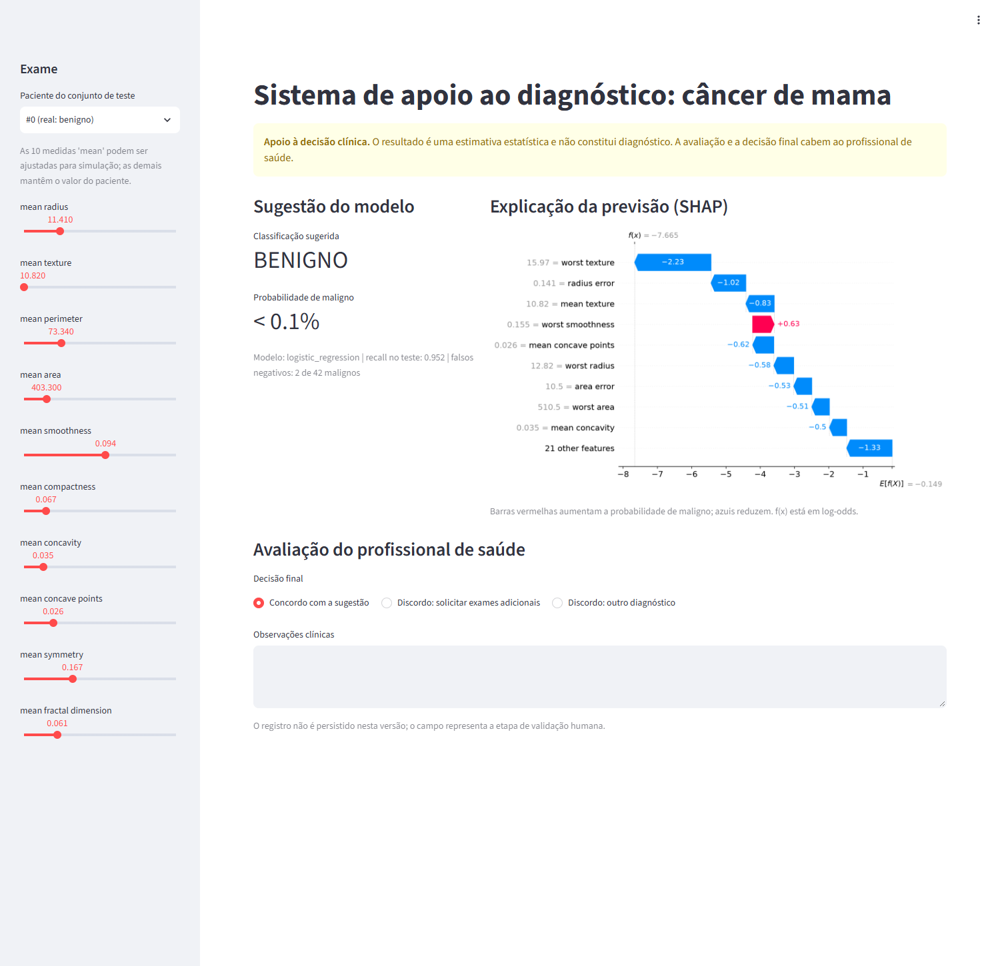

Caso na faixa intermediária (paciente #112, maligno): probabilidade de 46,5%, classificado como benigno pelo
limiar de 0,5. A interface emite o alerta de incerteza, e o waterfall mostra contribuições conflitantes
(`worst symmetry` e `worst smoothness` em direção a maligno, `worst texture` em direção a benigno). É o cenário em
que a revisão do profissional tem maior impacto.

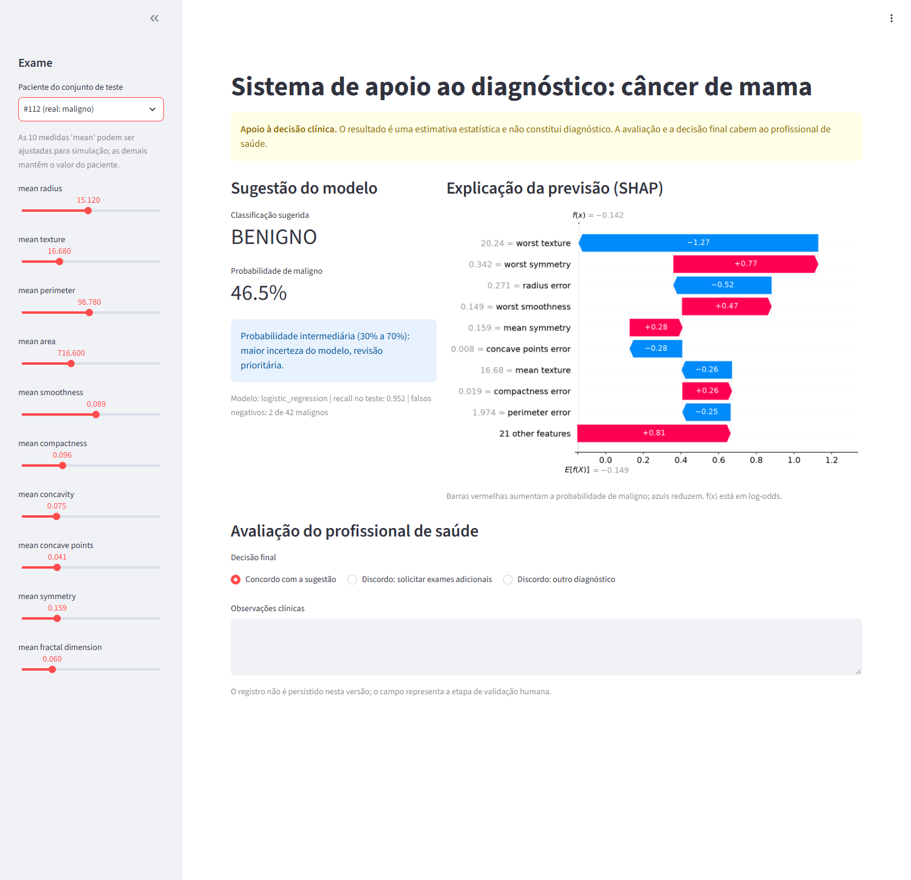

Falso negativo de baixa probabilidade (paciente #16, maligno): probabilidade de 7,0%. O valor de `worst texture`
(20,86) e as medidas de tamanho próximas da faixa benigna conduzem a previsão para benigno. Nenhum alerta é
emitido, o que reforça que o sistema não substitui a avaliação clínica de todos os casos.

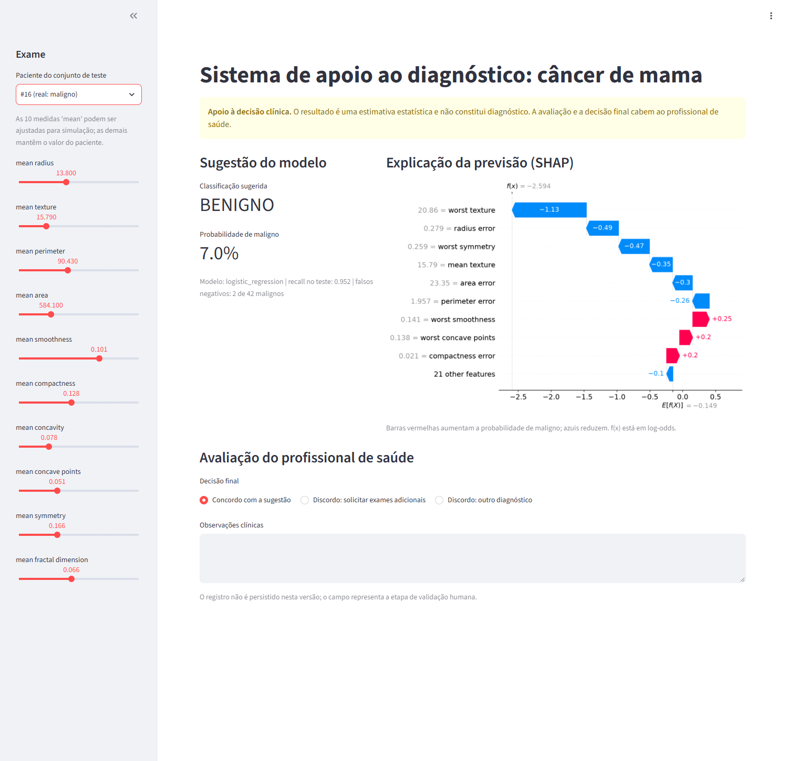

## 10. Reprodutibilidade

- Código organizado em módulos (`src/`), com 14 testes automatizados (`pytest`).
- `python -m src.run_pipeline` reproduz todas as tabelas e figuras deste relatório.
- Versões das bibliotecas fixadas em `requirements.txt`; `random_state=42` em todas as etapas aleatórias.
- `Dockerfile` empacota o treinamento e a interface.
